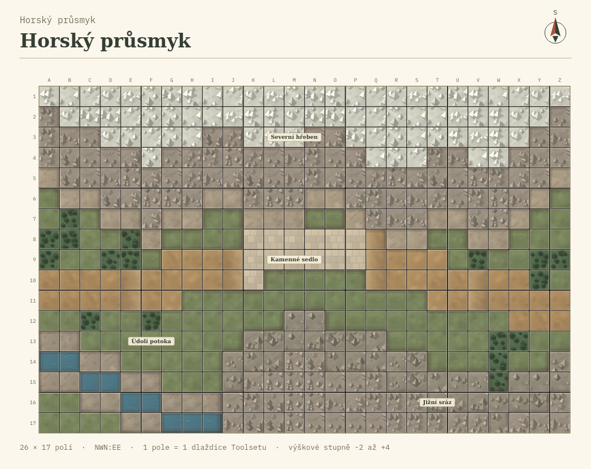

# Kartograf

Český desktopový editor čtvercových map pro D&D a Neverwinter Nights. Kreslí terén a interiéry, skládá půdorysy do mapy světa a exportuje PNG nebo PDF. Import Neverwinter Nights používá místní data hry.

## Spuštění na Linuxu

Kartograf potřebuje Python 3.10+ a PyQt5 s Qt 5.15. Na Debianu a Ubuntu tyto závislosti poskytují balíky `python3` a `python3-pyqt5`. Volitelný balík `python3-pil` urychlí dekódování textur DDS.

```bash
git clone https://github.com/Belphareon-bak/DnD-Kartograf.git
cd DnD-Kartograf
/usr/bin/python3 -B kartograf.py
```

## Ukázka

**Soubor → Ukázka horského průsmyku** nebo `./kartograf.py --demo` otevře editorovou mapu se čtyřmi rampami, sedlem mezi hřebeny a údolím potoka. Přiložený soubor lze otevřít přímo přes **Ctrl+O**. [Editovatelný projekt](ukazky/horsky-prusmyk.kartograf) · [Export PNG](ukazky/horsky-prusmyk.png)



## Úvodní plocha

Po spuštění si vyber naposledy otevřený projekt nebo modul, případně založ nový projekt. Historie uvádí typ souboru a název. Na seznam se můžeš vrátit přes **Soubor → Zavřít projekt**. Volba **Soubor → Nastavení → Otevřít poslední rozpracovanou relaci** při příštím spuštění znovu otevře poslední soubor a obnoví aktivní oblast a typ zobrazení. Úpravy se ukládají do souboru `.kartograf`.

## První mapa

1. V nabídce **Soubor** vyber **Nový projekt**. Urči rozměry v polích, měřítko a směr severu. Vpravo tlačítkem **+** přidáš další oblast.
2. V levé paletě rozbal kategorii a vyber podklad, stěnu, dveře nebo značku. Podklady se malují do pole, stěny a dveře se zachytávají na jeho hranu. Kolečko přibližuje a mezerník s tahem posouvá plátno.
3. Nástrojem **Výběr** otevři vlastnosti prvku. U průchodu vyber cílovou oblast a pole. Můžeš přidat zpáteční průchod. U monster lze upravit CR a u dveří a pastí TO / DC. Úpravy formuláře potvrď tlačítkem **Použít změny**.
4. Pro obkreslování použij **Oblasti → ⋯ → Vložit obrázkovou předlohu**. V nastavení lze sladit její rozměry a posun s rastrem, změnit průhlednost a vybrat vrstvu. Otočení oblasti posune i původní předlohu, hrany a příchody z jiných oblastí.
5. **Uložit** zapisuje editovatelný projekt `.kartograf` včetně vložených předloh. **Exportovat** vytváří PDF nebo PNG z aktivního pohledu. **Mapa světa** exportuje celý zvolený rozsah v aktuálním rozložení a **Detail oblasti** celý otevřený půdorys. Do výstupu se promítnou i neuložené úpravy. Přiblížení a posun ovlivňují prohlížení. Volba **Velikost → Výchozí** přizpůsobí rozměry celému obsahu a vedle volby ukáže šířku a výšku v pixelech. U PDF jde o přepočet při 180 dpi. Export může zahrnout mřížku, legendu a viditelnou předlohu. Hráčská varianta skryje prvky označené jako tajné.

V **Mapě světa** zapni **Poklady** vedle **Vstupů** a **Spojení**. Poklady na povrchu dostanou značku a vstup, odkud k pokladu vede cesta uvnitř, zlatý kroužek. Zapnutá vrstva se promítne i do PDF a PNG.

Mapa světa zahrnuje exteriéry a půdorysy napojené veřejným průchodem na společné hraně. Volba **Všechny oblasti** u přiblížení přidá skryté a další samostatné půdorysy. Export přebírá rozsah zvoleného pohledu. V pravém seznamu jsou dostupné všechny oblasti projektu. Kliknutí na oblast mimo plátno otevře její detail.

Dvojklik na oblast otevře její detail. Mřížku lze zapnout vedle přiblížení a stejnou volbu má export.

V detailu oblasti klikni nástrojem **Ruka** na značku. Vpravo uvidíš název a typ prvku. U přechodu je vidět cílová oblast a pole, tlačítko **Přejít na cíl** otevře místo příchodu. Tahem s nástrojem Ruka posuneš plátno. **Výběr** otevře také formulář pro úpravu značky.

Kliknutím na střet zobrazíš možné nestvůry, jejich CR a nastavení počtu. Kliknutím na název nestvůry otevřeš její kartu se statistikami z NWN. U postavy přímo umístěné v oblasti je v panelu tlačítko **Karta nestvůry**.

## Hory, svahy a propasti

V **Exteriéry → Hory a skály** najdeš horský masiv, suť, zasněžený hřeben a skálu. Podklad můžeš vybarvit samostatně a potom v kategorii **Reliéf** přidat kladné nebo záporné výškové stupně. Štětec mění každé pole jednou za tah. Pro celé plošiny lze použít **Obdélník**.

**Svah o 1 stupeň** spojuje dvě úrovně. Vyšší hranu otočíš klávesou **R**. Kartograf kreslí světlou hranu na horní straně schodu a stín na nižší straně. Stejně vysoké sousední hrany tvoří souvislou plochu.

## Import modulu Neverwinter Nights

1. Stiskni **Ctrl+I** nebo **Ctrl+O** a vyber místní soubor `.mod` pro NWN1 nebo NWN:EE ve formátu ERF V1.0. Zdroj a dostupná verze modulu se zobrazí v záhlaví a přehledu importu.
2. Kartograf vytvoří nový editovatelný projekt se všemi oblastmi modulu. Menší moduly otevře s celým rozložením. U rozsáhlých modulů začíná zobrazením povrchu a další oblasti přidá volba **Všechny oblasti**. Běžnou instalaci hry najde automaticky. Jinou lokaci lze zadat přes **Soubor → Složka dat NWN**. HAK hledá vedle modulu včetně podsložek `hak` a `haky` a také v uživatelském profilu hry.
3. Vyber oblast názvem nebo jejím herním identifikátorem a projekt ulož jako `.kartograf`. Importované výšky, povrchy i značky můžeš dál upravovat a exportovat.

Kartograf čte z tilesetu minimapu každé dlaždice a otočí ji podle modulu. Tyto herní podklady používá v mapě světa, detailu i exportu. Chybějící obrázky vykreslí podle rohů, výšek a křížení tilesetu. Souhrn importu ukáže počet dlaždic se skutečnou minimapou.

Ve zvětšeném pohledu vykresluje dlaždice z textových i binárních modelů NWN a jejich textur TGA či DDS. Podklady až 256 × 256 px vznikají z dat modulu, HAKů a instalace hry. Pro dlaždice bez vykreslitelného modelu použije původní minimapu. Tyto podklady se uloží do projektu a použijí se i při exportu.

U uloženého projektu obnovíš grafiku přes **Soubor → Aktualizovat dlaždice a vybavení z modulu NWN**. Kartograf ověří půdorys a načte nové podklady dlaždic i náhledy odpovídajících objektů. Funguje to i pro otočené oblasti. Změnu lze vrátit zpět.

Vrstva **Vybavení** dokreslí půdorysy objektů z textových modelů NWN a viditelné poznámky z herní mapy. Objekty mají polohu a natočení z modulu. Interaktivní objekt bez dostupného půdorysu dostane bodovou značku. Po najetí na objekt v přiblížené mapě uvidíš jeho název. Půdorysy a polohy se ukládají s projektem a promítají se i do PDF a PNG.

Z uložených objektů se přenesou nativní průchody, dveře, poznámky mapy, postavy, střety, pasti a kontejnery s inventářem. Poklad dostane značku i tehdy, když dostupný zdrojový NWScript přímo plní kontejner rozpoznaným generátorem nebo konkrétním předmětem. Průchody s nejednoznačným nebo chybějícím cílem mají v poznámce původní tag. Další objekty a spojení lze doplnit ručně. [Specifikace oblastí BioWare](https://nwn.wiki/download/attachments/327727/Bioware_Aurora_AreaFile_Format.pdf?api=v2)

U doložených obousměrných prahů se půdorysy přiloží ve stejné síti podle polohy spouští a směru příchodu. Mřížka ukazuje desetimetrové dlaždice Toolsetu a průběh stěn a chodeb určuje herní geometrie. U menších modulů se samostatný půdorys může zobrazit v mezeře poblíž svého přechodu, pokud se tam vejde.

Ve starším projektu použij **Soubor → Doplnit poklady z modulu NWN…** a vyber zdrojový modul. Kartograf doplní chybějící značky do odpovídajících půdorysů a zachová rozložení mapy.

Při importu se ukládají i karty nestvůr. Čtou údaje ze šablon UTC a přímo umístěných instancí GIT včetně životů, vlastností, povolání, bonusů, kouzel a herního popisu, pokud jsou dostupné. CR uvedené u střetu pochází z jeho seznamu možných nestvůr. Přirozený bonus k OČ a bonusy k záchranám se zobrazují podle uložených hodnot. [Formát nestvůr BioWare](https://github.com/xoreos/xoreos-docs/blob/master/specs/bioware/Creature_Format.pdf) · [Formát střetů BioWare](https://github.com/xoreos/xoreos-docs/blob/master/specs/bioware/Encounter_Format.pdf)

V již uložené mapě použij **Soubor → Doplnit střety a nestvůry z modulu NWN…**. Kartograf přiřadí karty k existujícím značkám v odpovídajících půdorysech. Doplnění lze vrátit zpět.

### Místní pravidla pro vlastní modul

Proměnná `KARTOGRAF_NWN_RULES` může při spuštění ukazovat na místní soubor JSON. Všechna jeho pole jsou volitelná. Pole `placements` ukládá pro oblast souřadnice, počet otočení o 90° a rozměry v dlaždicích. `surface` určuje exteriéry mezi oblastmi s automatickou klasifikací, pokud se identifikátory z `placements` shodují s modulem. `transition_scripts` uvádí známé skripty, které čtou cílový tag z proměnné spouště `target`. `overlay` přiloží půdorysy podle dvojice nativních spouští.

```json
{
  "surface": ["yard"],
  "placements": {"yard": [0, 0, 0, 12, 8]},
  "transition_scripts": ["map_travel"],
  "overlay": {
    "host": "hall", "area": "store", "tileset": "custom_tiles",
    "entry_tag": "to_store", "exit_tag": "to_hall", "empty_color": "#000000"
  }
}
```

## Zkoušky

Balík `poppler-utils` umožní ověřit i rozměry, text a zobrazení exportovaných PDF.

```bash
QT_QPA_PLATFORM=offscreen /usr/bin/python3 -B -m unittest -v
```

Katalog nabízí obecnou značku pro vlastní protivníky a výběr pojmenovaných monster D&D 5e seřazených v kategoriích podle CR.

This work includes material adapted from the [System Reference Document 5.1](https://media.dndbeyond.com/compendium-images/srd/5.1/SRD_CC_v5.1.pdf) by Wizards of the Coast LLC under [CC BY 4.0](https://creativecommons.org/licenses/by/4.0/). It uses a selection of monster names and challenge ratings, with Czech labels.

Formáty binárních modelů NWN a komprimovaných textur popisuje dokumentace xoreos. [NWN1MDL](https://github.com/xoreos/xoreos-docs/blob/master/templates/NWN1MDL.bt) · [DDS](https://github.com/xoreos/xoreos/blob/master/src/graphics/images/dds.cpp)
